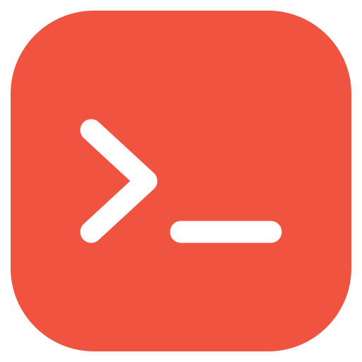

<p align="center">
  
</p>

<h1 align="center">DevEz</h1>

<p align="center">
  <strong>Fast, Lightweight, Native PHP & Laravel Development Environment.</strong><br>
  Instant <code>.test</code> domains with trusted HTTPS, isolated PHP versions, background queues & schedulers, database tools, Cloudflare tunnels, and AI MCP integration.<br>
  <strong>macOS · Windows · Linux</strong> — Native background processes, completely Docker-free.
</p>

<p align="center">
  <a href="https://github.com/rabbi696/DevEz"></a>
  
  
  
  <a href="LICENSE"></a>
</p>

---

## ⚡ What is DevEz?

**DevEz** is an all-in-one local development suite for PHP and Laravel developers inspired by Laravel Herd. Unlike heavy Docker setups or virtual machines, DevEz runs PHP, Node.js, databases, and proxy servers as **native system processes**, offering near-zero memory footprint and blazing-fast response times.

> **Note:** DevEz is based on and forked from the open-source [Flock](https://github.com/flock-php/flock) project, enhanced with Herd Pro-equivalent background workers, database integrations, Cloudflare tunnel toggles, custom rootless ports, and AI coding agent support.

---

## ✨ Features at a Glance

### 🚀 Core Performance & Web
- **Rootless & Conflict-Free:** Serves HTTPS on port **`8443`** and HTTP on port **`8080`** by default so it never clashes with existing web servers or Mac system apps on ports 80/443.
- **Automatic `.test` Domains & SSL:** Park your projects folder or link individual sites to get instant `<name>.test` local domains with trusted SSL certificates.
- **Side-by-Side PHP Versions:** Concurrently run PHP 8.1, 8.2, 8.3, 8.4, and 8.5. Pin versions per project via `.devezrc` or `.flockrc`.
- **FrankenPHP & Laravel Octane:** Built-in high-performance FrankenPHP support with seamless Laravel Octane worker mode.
- **Node.js Runtime Management:** Automatic Node version detection respecting `.nvmrc`.

### 🔄 Laravel Herd Pro-Equivalent Tools
- **Background Queue Workers:** Supervise `php artisan queue:work` per site in the background with auto-restart, live logs, and status monitoring (`devez queue`).
- **Background Task Schedulers:** Supervise `php artisan schedule:work` per site in the background without keeping a terminal window open (`devez schedule`).

### 🗄️ Database & Storage Tools
- **One-Click Client Launch:** Instantly launch and connect your project database in **TablePlus**, **TablePro**, or **DBeaver** (`devez db open`).
- **Database Backup & Restore:** Dump and import project databases with one command (`devez db dump`, `devez db import`).
- **Native Managed Services:** One-click install and run for PostgreSQL, MySQL, MariaDB, MongoDB, Redis, Valkey, Meilisearch, and Typesense.

### 📡 Cloudflare Tunnels (Per-Site Toggles)
- **1-Click GUI Toggle:** Start and stop public Cloudflare tunnels directly from the macOS menu bar panel.
- **Quick Copy & QR Codes:** Instant public preview URL copied to clipboard, plus mobile testing QR codes in the GUI.
- **Background CLI Management:** Run non-blocking tunnels via `devez tunnel on/off/status` or interactive sharing via `devez share`.

### 🤖 AI Agent & Antigravity MCP Integration
- **Model Context Protocol (MCP):** Connects directly with **Google Antigravity**, Claude Code, Cursor, and Windsurf.
- **Developer Tools for AI:** Exposes safe tools to inspect logs, execute artisan tasks, check database connection parameters, and diagnose local site errors.

### 📬 Local Mail & Debugging
- **Local Mail Catcher & Web UI:** Catches outgoing emails on port `2525`. Inspect messages in the native macOS app or via the browser-based Webmail client (`http://127.0.0.1:8080/mail` or `devez open --mail`).
- **`dump()` & Debug Timeline:** Intercepts `dump()`, `dd()`, SQL queries, and logs without breaking HTML or JSON responses.
- **On-Demand Xdebug:** Enable Xdebug only when needed with zero overhead during normal requests.
- **System Doctor (`devez doctor`):** Automatically checks DNS resolution, SSL trust, ports, binary runtimes, and auto-fixes configuration issues.

---

## 💻 Quick Start & Commands

```sh
# --- Site Setup ---
devez park                  # Park current directory (serves every child folder as <folder>.test)
devez link my-app           # Link specific project folder as a site
devez secure my-app         # Issue trusted local SSL certificate
devez status                # View status of daemon, sites, and services

# --- PHP & Runtimes ---
devez php install 8.4       # Install a specific PHP version
devez pin php 8.4           # Pin project to PHP 8.4 (creates .devezrc)

# --- Databases ---
devez services install mysql       # Install and start MySQL
devez services install postgres    # Install and start PostgreSQL
devez db open                      # Open site database in TablePlus / TablePro
devez db dump                      # Export database to backup.sql
devez db import backup.sql         # Import database from file

# --- Background Queue & Scheduler ---
devez queue start                  # Start background queue worker
devez queue status                 # Check running worker status
devez queue logs                   # Tail queue worker log output
devez schedule start               # Start background schedule runner
devez schedule status              # Check running scheduler status

# --- Cloudflare Tunnels ---
devez tunnel on my-app             # Start background tunnel & copy public URL
devez tunnel status                # List all active public tunnels
devez tunnel off my-app            # Stop background tunnel
devez tunnel my-app                # Toggle tunnel on/off

# --- Productivity & Diagnostics ---
devez open                         # Open current site in default browser
devez code                         # Open current site in VS Code / IDE
devez doctor                       # Run system diagnostics
devez doctor --fix                 # Auto-repair common environment issues
devez ports                        # View listening ports
devez port set https 8443          # Change listening SSL port
```

*(Note: For backward compatibility, the `flock` command alias is also fully supported.)*

---

## 🌐 Default Ports

| Service | Port | Description |
| :--- | :--- | :--- |
| **HTTPS (SSL)** | `8443` | Rootless, conflict-free HTTPS (`https://my-app.test:8443` or mapped via proxy) |
| **HTTP** | `8080` | Local HTTP web traffic |
| **SMTP Mail** | `2525` | Local test mail server |
| **Webmail UI** | Embedded | Access via `devez open --mail` or `http://127.0.0.1:<daemon_port>/mail` |

---

## 🛠️ Building from Source (macOS, Linux, Windows)

### Prerequisites
- **Go:** 1.27+
- **Swift:** 6.0+ (for macOS menu bar app)
- **Make**

```sh
# 1. Build CLI binary (creates bin/devez and symlinks bin/flock)
make build

# 2. Run Go test suite
make test

# 3. Run Linter
make lint

# 4. Build native macOS Menu Bar App (outputs to build/macos/DevEz.app)
SKIP_DMG=1 ./macos/build-app.sh

# 5. Run Swift test suite
cd macos && swift test
```

---

## 🔄 Syncing with Upstream

To keep DevEz updated with changes from upstream:

```sh
git fetch upstream
git merge upstream/main
make test
make build
```

---

## 📄 License & Acknowledgments

DevEz is free, open-source software licensed under the [GNU Affero General Public License v3.0](LICENSE).  
DevEz is based on and forked from the **[Flock](https://github.com/flock-php/flock)** project created by **[Guava](https://guava.cz/en)** and its contributors.

DevEz is not affiliated with or endorsed by Laravel LLC or Laravel Herd.
